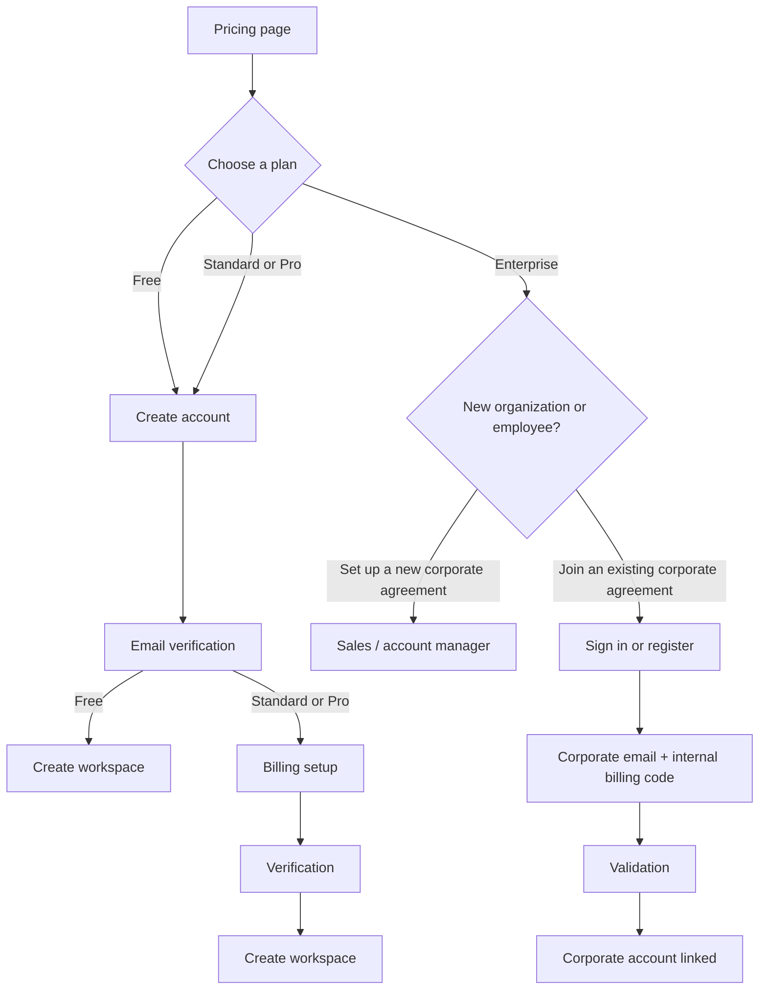

# Create account

To start using NeuroStack, select a plan on the Pricing page and create an account.

The next steps depend on the selected plan.

## User journeys

Depending on the selected plan, your path through account creation and billing setup differs:

## Choose a plan

On the Pricing page, choose one of the available plans:

- **Free**
- **Standard**
- **Pro**
- **Enterprise**

Selecting a plan determines the next steps in the user journey.

## Create an account

After selecting a plan, create an individual NeuroStack account:

1. Enter your email address and create a password.
2. Confirm your email address.

Email verification codes are valid for 10 minutes, can be used only once, and allow a maximum of five incorrect attempts. Requesting a new code invalidates the previous one.

## Free plan

If you selected the Free plan, no payment method or billing verification is required.

After email verification, you can create a workspace within Free plan limits.

## Standard and Pro plans

If you selected Standard or Pro, complete billing setup:

1. Choose how you will pay:
   - **Card** — pay personally with a payment card.
   - **Invoice** — pay personally by invoice.
2. Provide the required billing details.
3. Wait while NeuroStack verifies the billing details.

For Card, verification is usually immediate. For Invoice, verification can take up to 5 business days.

Once the billing account is Active, you can create workspaces within the selected plan's limits.

## Enterprise plan

If you selected Enterprise, choose one of the following options:

- **Set up a new corporate agreement** — contact the NeuroStack sales team and work with an account manager to establish the corporate agreement and billing arrangement.
- **Join an existing corporate agreement** — connect your account to your organization's existing corporate agreement.

### Join an existing corporate agreement

1. Create a NeuroStack account or sign in to an existing account.
2. Provide and verify a corporate email address, if it has not been verified yet.
3. Enter the internal billing code provided by your organization.
4. NeuroStack validates the code and checks that your email domain matches the organization associated with the code.
5. After validation, your account is linked to the organization's corporate billing account.

You do not need to add a personal payment method or select an individual billing arrangement. Questions about invoices, deposits, or other payment arrangements within your company are handled by your organization, not by NeuroStack.

## Billing account statuses

The following statuses apply to a billing account:

| Status | When used | What is available |
|---|---|---|
| Pending | A paid-plan billing setup has been submitted but has not yet passed initial verification. | Workspace creation is unavailable until verification is complete. |
| Failed | Verification of the billing setup has finally failed. | The user must correct the details or choose a different billing arrangement. |
| Active | Verification has passed and there is no overdue debt. | The user can create workspaces and use paid resources. |
| Payment overdue | The payment due date has passed and payment has not been received. | New paid resources cannot be created. Existing resources continue to run during the grace period. |
| Suspended | The grace period has ended without payment. | Paid resources are unavailable; running resources are stopped. |

## Learn more

- For more details about billing arrangements and billing account statuses, see [Billing account](../concepts/billing-account.md).
- For help with account creation, billing, and billing account statuses, see [Billing issues](../troubleshooting/billing-issues.md).

## What's next

- [Create a Workspace](create-workspace.md)
- [Start a Jupyter Server](start-jupyter.md)
