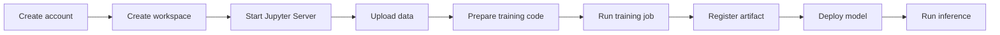

# Getting started

This section helps you start working with NeuroStack: from creating an account to running your first inference request.

Follow the steps in order. Each step builds on the previous one and results in a working part of your ML workflow.

## Prerequisites

Before you begin, make sure you have:

- An email address to create a NeuroStack account.
- A payment card or invoice details, if you plan to use a paid plan.
- An internal billing code from your organization, if your company pays for NeuroStack.

## Workflow overview

### Covered

- [Create account](./create_account.md)

## After you finish

Once you complete all steps, you will have a working ML workflow: a trained model deployed as an API endpoint that returns predictions.

To learn more about individual platform resources and concepts, see [Concepts](../concepts/index.md).

If you run into problems, see Troubleshooting.
