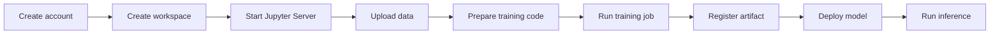

# Getting started

This section helps you start working with NeuroStack: from setting up billing to running your first inference request.

Follow the steps in order. Each step builds on the previous one and results in a working part of your ML workflow.

## Prerequisites

Before you begin, make sure you have:

- A NeuroStack account with access to the Web Console.
- A payment method or internal billing code.

See [Prerequisites](./prerequisites.md) for details.

## Workflow overview

## Steps

1. [Create-account](./.md) — set up billing.
2. [Create a workspace](./create-workspace.md) — create an isolated environment for your ML project.
3. [Start a Jupyter Server](./start-jupyter.md) — launch a managed development environment.
4. [Upload data](./upload-data.md) — add datasets to object storage.
5. [Prepare training code](./prepare-training-code.md) — write or upload the code that trains your model.
6. [Run a training job](./run-training-job.md) — train your model on managed compute resources.
7. [Register a model artifact](./register-artifact.md) — save the trained model for deployment.
8. [Deploy the model](./deploy-model.md) — expose the model through an API endpoint.
9. [Run inference](./run-inference.md) — send a request to the endpoint and get a prediction.

## After you finish

Once you complete all steps, you will have a working ML workflow: a trained model deployed as an API endpoint that returns predictions.

To learn more about individual platform resources and concepts, see [Concepts](../concepts/index.md).

If you run into problems, see [Troubleshooting](../troubleshooting/index.md).
