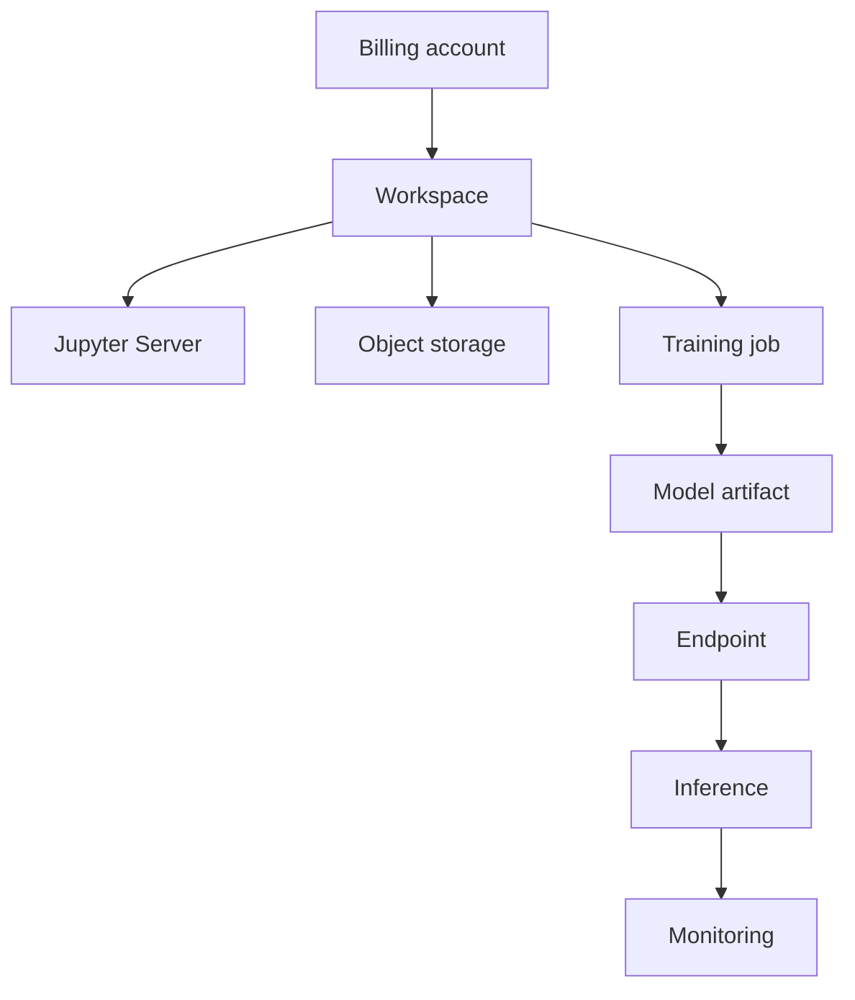

# Platform architecture

NeuroStack organizes ML development and deployment around workspaces, managed compute resources, object storage, and model endpoints.

This page describes the platform at a conceptual level. It explains the main components and their relationships rather than the underlying infrastructure implementation.

## Main components

### Billing account

A billing account determines whether a user can create and use paid platform resources. Before creating a workspace, you must connect a payment method and ensure that the billing account is active.

### Workspace

A workspace provides an isolated environment for an ML project. It brings together compute resources, object storage, user permissions, billing, and project settings.

A workspace is created in a specific region.

### Jupyter Server

A Jupyter Server provides a managed development environment within a workspace. You can use it to prepare data, develop ML code, and prepare training workloads.

Jupyter environments support CPU and GPU compute configurations.

### Object storage

Object storage holds datasets and model artifacts used in ML workflows.

### Training job

A training job runs code that trains a machine learning model using data and compute resources.

### Model artifact

A model artifact is a stored snapshot of a trained model. You can register an artifact and use it in a deployment workflow.

### Endpoint

An endpoint exposes a deployed model through an API. Clients send inference requests to the endpoint and receive model responses.

NeuroStack endpoints support auto-scaling. The specific scaling policies and configuration options are not defined in this overview.

### Monitoring

NeuroStack provides monitoring for deployed endpoints, covering endpoint health, performance, and resource usage.

## Component relationships

The billing account is the entry point for using paid resources. A workspace groups the resources needed for an ML project. Within a workspace, the Jupyter Server supports development, object storage holds data and artifacts, training jobs produce model artifacts, and endpoints expose deployed models for inference.

## Typical workflow

1. Create-account and connect a payment method.
2. Create a workspace in a selected region.
3. Start a Jupyter Server and prepare your data and training code.
4. Run a training job.
5. Register the resulting model artifact.
6. Deploy the model to an endpoint.
7. Send inference requests to the endpoint.
8. Monitor endpoint health, performance, and resource usage.

The REST API and CLI provide additional ways to interact with platform resources and automate operations.

## Regions and availability

NeuroStack workspaces are created in a specific region. Region selection affects resource location, latency, availability, and potentially cost.

The platform currently supports the following example regions:

| Region identifier | Description |
|---|---|
| `ru-central1` | Central Russia region |
| `eu-central1` | Central Europe region |

The full list of supported regions and availability zones is not yet defined.

## Access control

NeuroStack uses role-based access control (RBAC) at the workspace level. Each user has a workspace role — Owner, Admin, Editor, or Viewer — that applies to all resources within the workspace.

Permission inheritance and per-resource overrides are not supported. See [Access control](../concepts/access-control.md) for details.

## Scope of this overview

This page describes the logical components of NeuroStack. It does not specify the internal infrastructure, service topology, networking, data-transfer mechanisms, or implementation details of the platform.
