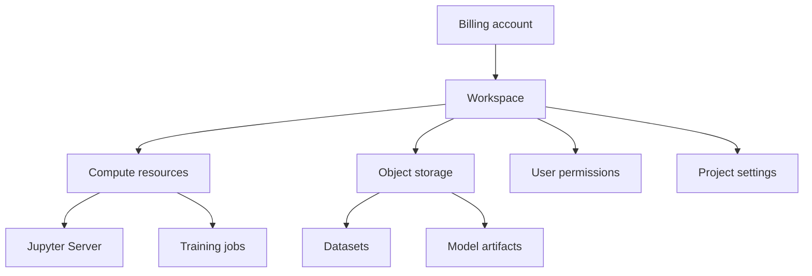

# Resource hierarchy

NeuroStack organizes project resources around workspaces. A billing account must be active before you can create a workspace and use paid resources.

Understanding this hierarchy helps you identify where a resource belongs and which settings and permissions apply to it.

## Billing account

The billing account is a prerequisite for creating workspaces and using paid resources.

It has its own billing status and payment method. An inactive or suspended billing account restricts access to paid operations.

NeuroStack does not currently define an organization-level resource; the billing account is the top-level container for platform resources.

See [Billing account](../concepts/billing-account.md) for details.

## Workspace

A workspace is an isolated environment for an ML project. It brings together the resources and settings needed to develop and deploy models.

A workspace includes:

- compute resources;
- object storage;
- user permissions;
- billing;
- project settings.

A workspace is created in a specific region. Workspace quotas depend on the billing plan.

See [Workspace](../concepts/workspace.md) and [Region](../concepts/region.md) for details.

## Resources within a workspace

The workspace is the main organizational boundary for the project's resources and settings.

| Resource or component | Purpose |
|---|---|
| Jupyter Server | Provides a managed environment for developing ML code and preparing data. |
| Object storage | Stores datasets and model artifacts. |
| Training job | Runs the code that trains an ML model. |
| Model artifact | Stores a snapshot of a trained model for subsequent use. |
| Model endpoint | Exposes a deployed model for inference requests. |
| Monitoring | Provides information about endpoint health, performance, and resource usage. |

These components support the ML workflow from development through deployment and inference.

## Hierarchy and workflow

The ML workflow follows these stages:

The diagrams are conceptual. They show the main resource relationships and workflow stages; they do not define the physical deployment topology or imply that every component is implemented as a child resource in the platform API.

## Permissions

Workspace roles apply to all resources within the workspace, including Jupyter Servers, training jobs, model artifacts, and endpoints.

Permissions cannot be changed for individual resources. See [Access control](../concepts/access-control.md) for details.

## Resource limits

Workspace and Jupyter Server quotas depend on the billing plan.

| Plan | Workspaces | Jupyter Servers per workspace |
|------|------------|-------------------------------|
| Free | 1 | 1 |
| Standard | 5 | 3 |
| Pro | 20 | 10 |
| Enterprise | Custom | Custom |

Other resource quotas may also depend on the plan. See [Quotas](../reference/quotas.md) for the applicable limits.

## Related documentation

- [Billing account](../concepts/billing-account.md)
- [Workspace](../concepts/workspace.md)
- [Jupyter Server](../concepts/jupyter-server.md)
- [Training job](../concepts/training-job.md)
- [Model artifact](../concepts/artifact.md)
- [Endpoint](../concepts/endpoint.md)
- [Region](../concepts/region.md)
- [Access control](../concepts/access-control.md)
