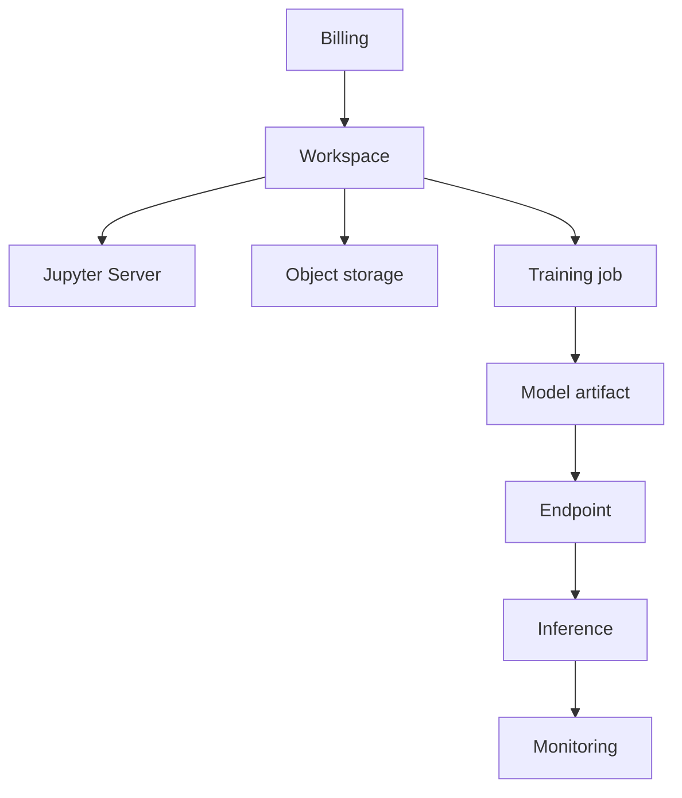

# Resource hierarchy

NeuroStack organizes project resources around workspaces. A user must create an account and complete the billing setup required for the selected plan before creating a workspace and using paid resources.

Understanding this hierarchy helps you identify where a resource belongs and which settings and permissions apply to it.

## Billing

A billing arrangement connects a user account or organization to payment for NeuroStack resources. NeuroStack supports three billing arrangements: card, invoice, and internal billing code.

A corporate organization has a single corporate billing arrangement linked to a single agreement with NeuroStack. Employee accounts are linked to the organization's corporate billing.

The billing status determines whether a user can create and use paid resources. See [Billing](../concepts/billing.md) for details.

## Workspace

A workspace is an isolated environment for an ML project. It brings together the resources and settings needed to develop and deploy models.

A workspace includes:

- compute resources;
- object storage;
- user permissions;
- project settings.

A workspace is created in a specific region. Workspace quotas depend on the billing plan.

See [Workspace](../concepts/workspace.md) for details.

## Resources within a workspace

The workspace is the main organizational boundary for the project's resources and settings.

| Resource or component | Purpose |
|---|---|
| Jupyter Server | Provides a managed environment for developing ML code and preparing data. |
| Object storage | Stores datasets and model artifacts. |
| Training job | Runs the code that trains an ML model. |
| Model artifact | Stores a snapshot of a trained model for subsequent use. |
| Model endpoint | Exposes a deployed model for inference requests. |
| Monitoring | Provides information about endpoint health, performance, and resource usage. |

These components support the ML workflow from development through deployment and inference.

## Hierarchy and workflow

The ML workflow follows these stages:

The diagrams are conceptual. They show the main resource relationships and workflow stages; they do not define the physical deployment topology or imply that every component is implemented as a child resource in the platform API.

## Permissions

Workspace roles apply to all resources within the workspace, including Jupyter Servers, training jobs, model artifacts, and endpoints.

Permissions cannot be changed for individual resources.

## Resource limits

Workspace and Jupyter Server quotas depend on the billing plan.

| Plan | Workspaces | Jupyter Servers per workspace |
|------|------------|-------------------------------|
| Free | 1 | 1 |
| Standard | 5 | 3 |
| Pro | 20 | 10 |
| Enterprise | Custom | Custom |

Other resource quotas may also depend on the plan.

## Related documentation

- [Billing](../concepts/billing.md)
