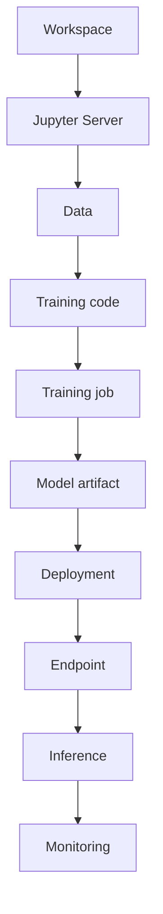

# Product Decisions

**Last updated:** October 2026

This document records product decisions, assumptions, and constraints made while developing the fictional NeuroStack product model.

NeuroStack is a portfolio project. Some product details are intentionally simplified or defined specifically to support the documentation exercise.

When a detail is not defined here or in the product documentation, it should not be treated as established product behavior.

---

## Product Scope

NeuroStack is a cloud platform for developing, training, deploying, and monitoring machine learning models.

The platform provides:

- managed Jupyter environments;
- CPU and GPU compute resources;
- object storage for datasets and model artifacts;
- training jobs;
- model artifacts and model management;
- API endpoints for model deployment;
- inference;
- monitoring;
- REST API and CLI access.

NeuroStack is documented as a cloud product rather than as a generic collection of ML tools.

---

## Plan Selection and Entry Point

The Pricing page is the entry point to the NeuroStack user journey. It presents the available plans side by side, including their prices and limits where defined.

Each plan has a "Choose plan" button. Selecting a plan determines the next steps in the user journey.

### Free Plan

1. The user selects Free.
2. The user creates an account and verifies their email address.
3. The user can create a workspace within Free plan limits.

The Free plan does not require a payment method or billing verification.

### Standard and Pro Plans

1. The user selects Standard or Pro.
2. The user creates an account and verifies their email address.
3. The user selects a billing arrangement and completes the required billing setup.
4. NeuroStack verifies the billing details.
5. Once the billing account is Active, the user can create workspaces within the selected plan's limits.

### Enterprise Plan

After selecting Enterprise, the user is shown an intermediate screen with two options:

- **Set up a new corporate agreement**
- **Join an existing corporate agreement**

The user must choose one of these options before proceeding. The first option leads to the sales contact flow; the second leads to the existing corporate agreement connection flow.

- **Set up a new corporate agreement** — for an organization that wants to establish a new corporate agreement with NeuroStack. The user contacts NeuroStack's sales team and works with an account manager to arrange the agreement and billing setup.
- **Join an existing corporate agreement** — for an employee whose organization already has an active NeuroStack corporate agreement. The user follows the corporate account connection flow using a corporate email address and an internal billing code.

Employees joining an existing corporate agreement do not select an individual payment method or become personally responsible for corporate charges.

---

## Documentation Model

The documentation follows a Docs-as-Code approach.

The documentation set is organized around:

- Overview
- Getting Started
- Concepts
- Tutorials
- How-to Guides
- Reference
- Troubleshooting
- FAQ
- Best Practices
- Release Notes
- Glossary

The documentation distinguishes between:

- **Concepts** — explain what a platform resource or concept is;
- **Tutorials** — guide users through a complete scenario;
- **How-to Guides** — explain how to complete a specific task;
- **Reference** — provide precise technical information;
- **Troubleshooting** — help users diagnose and resolve problems.

The Getting Started path follows a complete user journey from billing setup to the first model inference.

---

## Account and Billing

### Accounts and organizations

Each user has an individual NeuroStack account. Users do not share a single login for an organization.

A corporate organization has a single corporate billing account linked to a single agreement with NeuroStack. Employee accounts are linked to the corporate organization and its billing.

Workspaces are created per project, not automatically per user. One user can work in several workspaces, and several users can participate in one workspace.

### Registration

Users select a plan on the Pricing page before creating an account.

After selecting a plan, the user creates an individual NeuroStack account using an email address and password, then verifies the email address.

Email verification codes:

- Are valid for 10 minutes.
- Can be used only once.
- Allow a maximum of 5 incorrect attempts.
- Are invalidated when a new code is requested.

The next steps depend on the selected plan:

- **Free:** After email verification, the user can create a workspace within Free plan limits. No payment method or billing verification is required.
- **Standard and Pro:** The user must complete the required billing setup and pass billing verification before creating a workspace.
- **Enterprise — new corporate agreement:** The user contacts the sales team and works with an account manager to establish the corporate agreement and billing arrangement.
- **Enterprise — existing corporate agreement:** The user follows the flow for joining an existing corporate agreement. The account is linked to the organization's corporate billing account after the internal billing code and corporate email are validated.

Selecting a plan does not by itself activate a paid subscription or authorize the creation of paid resources.

### Billing setup

A billing setup connects a user account or organization to a billing arrangement. NeuroStack supports three billing arrangements:

- **Card** — a personal or corporate card validated through the payment provider.
- **Invoice** — for organizations paying by bank transfer.
- **Internal billing code** — a corporate identifier that links a user account to an existing corporate billing agreement.

An internal billing code is not a payment method. It links the user to an existing corporate billing arrangement; charges are billed to the organization under the corporate agreement.

### Billing account statuses

The following statuses apply to a billing account:

| Status | When used | What is available |
|---|---|---|
| Pending | A paid-plan billing setup has been submitted but has not yet passed initial verification. | Workspace creation is unavailable until verification is complete. |
| Failed | Verification of the billing setup has finally failed. | The user must correct the details or choose a different billing arrangement. |
| Active | Verification has passed and there is no overdue debt. | The user can create workspaces and use paid resources. |
| Payment overdue | The payment due date has passed and payment has not been received. | New paid resources cannot be created. Existing resources continue to run during the grace period. |
| Suspended | The grace period has ended without payment. | Paid resources are unavailable; running resources are stopped. |

### Billing cycle and grace period

The billing cycle for an individual paid plan begins when the billing account becomes Active and repeats every 30 days.

Charges are collected according to the selected billing arrangement:

- **Card** — charges are billed automatically to the card.
- **Invoice** — invoices are issued once every 30 days and paid by bank transfer.
- **Internal billing code** — charges are billed to the organization under the corporate agreement, using the same 30-day invoice cycle.

Invoices are due within 30 days of issuance. Account activation does not depend on whether any charges have been paid.

**Card payments**

NeuroStack attempts to charge the card on each billing date. If the first charge attempt fails, the billing account transitions to `Payment overdue` and a seven-day grace period begins, measured from the date of the first failed charge attempt.

During the grace period, NeuroStack automatically retries the charge. The user is notified that payment is overdue and shown the date when resources will be stopped if payment is not received.

If payment is received during the grace period, the billing account returns to `Active`. Existing resources continue to run without interruption.

If payment is not received by the end of the grace period, the billing account transitions to `Suspended`, and running resources are stopped.

**Invoice payments**

Each invoice has a specified payment due date. If payment has not been received by that date, the billing account transitions to `Payment overdue`, and a seven-day grace period begins.

During the grace period, existing resources continue to run, but users cannot create new paid resources. NeuroStack notifies the billing contact of the overdue invoice and the date when resources will be stopped if payment is not received.

If payment is received during the grace period, the billing account returns to `Active`. Existing resources continue to run without interruption.

If payment is not received by the end of the grace period, the billing account transitions to `Suspended`, and running resources are stopped.

If payment is received after the billing account has transitioned to `Suspended`, the billing account returns to `Active`. Stopped resources are not restarted automatically; the user must start the required resources manually.

A failed recurring charge is an event within the `Payment overdue` state, not a status change to `Failed`.

For Enterprise, the billing cycle is established at the corporate agreement level. Adding an employee to an existing corporate agreement does not start or reset the organization's billing cycle.

Selecting a plan does not start a billing cycle. The Free plan has no paid billing cycle and does not incur usage charges.

### Corporate billing status and user access

Billing account statuses describe the billing account, not the individual user account.

If a corporate billing account is in `Payment overdue` or `Suspended`, linked employees cannot create new paid resources, even if they have no personal debt. The user interface shows the state of the corporate billing to affected users.

The personal account status of an employee is not automatically changed to `Payment overdue` when the debt belongs to the organization.

### Card verification

Card details are validated through the payment provider. Verification is usually immediate.

If validation fails, the billing account status changes to **Failed**. The user sees a general message and can correct the card details and retry, or choose a different billing arrangement. NeuroStack does not display detailed bank decline reasons.

### Invoice verification

Invoice verification can take up to 5 business days, provided all required information has been submitted. If additional information or supporting documents are required, NeuroStack contacts the applicant by email. Verification may take longer than five business days if the requested information has not yet been received. The verification process resumes when the applicant provides the required information.

The invoice request form collects:

- Legal business name (required);
- Country of registration (required);
- Registered business address (required);
- Bill-to address (required if different);
- Business contact name (required);
- Business contact email (required);
- Accounts payable email (required);
- Tax ID / VAT ID (required depending on the country);
- Company registration number (required depending on the country);
- Purchase order number (optional);
- Supporting documents (requested only if needed for verification).

When verification is complete, NeuroStack sends an email to the account email address, and the status changes to **Active**.

### Internal billing code

An internal billing code connects an employee's NeuroStack account to an existing corporate billing agreement. It is issued by NeuroStack or an authorized account manager and is not a payment method or promotional code.

Employees joining an existing corporate agreement do not need to establish an individual billing arrangement. Charges for their use of NeuroStack are handled under the organization's corporate agreement.

The code is used during the initial connection to the corporate agreement, not at every login.

#### Joining an existing corporate agreement

1. The user selects Enterprise on the Pricing page.
2. The user selects "Join an existing corporate agreement."
3. If the user does not have a NeuroStack account, they create one. If they already have an account, they sign in.
4. The user provides and verifies a corporate email address if it has not already been verified.
5. The user enters the internal billing code.
6. NeuroStack validates the code and checks that the corporate email domain matches the organization associated with the code.
7. If validation succeeds, NeuroStack links the user's account to the organization's corporate billing account.
8. The user can access the workspaces and resources permitted by their organization and assigned workspace roles.

If the account's existing email address does not match the organization's corporate email domain, the user must provide and verify a matching corporate email address before the account can be linked.

If the code is invalid, expired, revoked, or does not match the corporate email domain, the account is not linked. The user is shown an error and can correct the details or contact their organization's authorized representative.

Joining a corporate agreement does not create an individual subscription, require the employee to provide a personal payment method, or make the employee personally responsible for corporate charges.

The organization's corporate billing status and agreement terms determine whether linked users can create or use paid resources.

### Revoking access and rotating the code

Revoking an individual employee's access and rotating the corporate code are separate operations.

**Revoking an employee's access:**

- The organization removes the employee's account from the corporate organization.
- Access to corporate resources is revoked immediately.
- Revoking access does not delete the employee's personal NeuroStack account.
- Other employees continue to work.
- The corporate code remains valid.
- The system revokes the user's membership, permissions, and, if necessary, active sessions and tokens.

**Rotating the code:**

Rotating the code is used when the code may have been compromised, shared outside the organization, or as part of planned access rotation.

When the code is rotated:

- The old code immediately stops working for new connections.
- A new code is issued to an authorized representative of the organization.
- Existing user links and active sessions are preserved.
- If the organization wants to remove specific employees, it does so separately.

Rotating the code does not automatically disconnect all existing employees.

### Offboarding from a corporate organization

When a user attempts to sign in to a corporate account after their corporate access has been revoked, NeuroStack informs them that their corporate access has been removed and offers to create a personal account using a personal email address.

The former corporate account is no longer available to the user. Corporate workspaces, data, and artifacts remain with the organization and are not transferred to the new personal account.

After creating a personal account and completing the standard billing setup, the user can start using NeuroStack with the Free plan.

Organizations cannot block a former employee from using NeuroStack entirely; they can only revoke the employee's access to their corporate organization and resources.

### Billing notifications

For corporate billing, a billing contact or accounts payable contact is designated when the corporate billing account is set up. Payment notifications are sent to this contact.

If the designated contact is no longer available, the organization updates the billing contact in the corporate billing account settings.

The status of the corporate billing is shown to all linked users affected by its restrictions.

---

## Workspaces

A workspace is an isolated environment for an ML project.

A workspace combines:

- compute resources;
- object storage;
- user permissions;
- billing;
- project settings.

A workspace can be created through:

- Web Console;
- CLI;
- REST API.

Workspace creation eligibility depends on the user's plan and billing status:

- **Free:** A user with a verified email address can create a workspace within Free plan limits without setting up paid billing.
- **Standard and Pro:** The user's billing account must be Active before a workspace can be created.
- **Enterprise:** The user's account must be linked to the organization's corporate billing account, and the organization must permit workspace creation under its agreement and access policies.

---

### Workspace Names

A workspace name is a technical resource identifier.

Workspace names may contain:

- Latin letters;
- numbers;
- hyphens.

Spaces, Cyrillic characters, and special characters are not supported.

The restriction exists because the workspace name is used as a technical identifier in APIs, CLI commands, URLs, and internal resource names.

---

### Regions

A workspace is created in a specified region.

Example region identifiers include:

- ru-central1
- eu-central1

The region API parameter is a string. The backend validates whether the requested region is supported.

This allows NeuroStack to add new regions without changing the API format or requiring clients to update a hardcoded list.

Region selection affects resource location, latency, availability, and potentially cost.

---

### Workspace Limits

Workspace and Jupyter Server limits depend on the billing plan.

| Plan | Workspaces | Jupyter Servers per workspace |
|------|------------|-------------------------------|
| Free | 1 | 1 |
| Standard | 5 | 3 |
| Pro | 20 | 10 |
| Enterprise | Custom | Custom |

Other resource quotas may also depend on the plan. Exact quotas are documented separately when defined.

---

### Workspace Roles

NeuroStack uses role-based access control.

**Owner**

Has full workspace access, including:

- billing management;
- user management;
- resource management.

**Admin**

Can manage:

- workspace resources;
- users;
- project settings.

An Admin cannot transfer workspace ownership.

**Editor**

Can work with project resources but cannot manage users or billing.

**Viewer**

Has read-only access to the workspace.

### Permission model

Workspace roles apply to all resources within the workspace, including Jupyter Servers, training jobs, model artifacts, and endpoints.

NeuroStack does not support individual permission overrides for specific resources. Permissions cannot be changed for a single resource without changing the user's workspace role.

This model keeps access control consistent across the workspace and avoids the need to manage permissions separately for each resource.

---

### Workspace Errors

The following workspace-related errors are defined:

- `BILLING_NOT_LINKED`
- `INSUFFICIENT_PERMISSIONS`
- `INTERNAL_ERROR`
- `WORKSPACE_LIMIT_EXCEEDED`

`BILLING_NOT_LINKED` means that the required billing account is not connected or active.

`INSUFFICIENT_PERMISSIONS` means that the current user does not have permission to perform the requested action.

`INTERNAL_ERROR` indicates an unexpected internal system failure rather than invalid user input.

`WORKSPACE_LIMIT_EXCEEDED` indicates that the workspace quota for the current plan has been reached.

---

## Jupyter Server

A Jupyter Server provides a managed development environment inside a workspace.

Users can select a compute configuration when starting a Jupyter Server.

Currently defined example configurations include:

| Configuration | CPU | RAM | GPU |
|---------------|-----|-----|-----|
| cpu-small | 2 vCPU | 8 GB | None |
| cpu-medium | 4 vCPU | 16 GB | None |
| gpu-small | 4 vCPU | 16 GB | 1 GPU |
| gpu-t4 | 8 vCPU | 32 GB | 1 × T4 |

CPU configurations are suitable for ordinary development and smaller workloads. GPU configurations are intended for workloads that benefit from GPU acceleration, such as deep learning.

Exact pricing and the complete list of supported configurations are not currently defined.

NeuroStack officially supports Python in Jupyter environments. Exact supported Python versions are not currently fixed.

---

## ML Workflow

The primary ML workflow documented by the project is:

Each stage has a corresponding concept or workflow in the documentation.

---

## Training Jobs

A training job is a background process that trains a machine learning model.

Training uses data and training code to produce a trained model.

NeuroStack handles the compute environment required to run the training job so users do not need to manage the underlying infrastructure directly.

Detailed training configuration, scheduling, and API schemas are not yet defined.

---

## Artifacts and Models

A model artifact is a stored snapshot of a trained model that can be registered and used for deployment.

The documentation distinguishes between:

- **artifact** — a stored output produced by a workflow;
- **model** — a trained ML model represented by a registered model artifact and used for deployment or inference.

The exact artifact registry API and metadata schema are not yet defined.

---

## Deployment and Endpoints

Deployment makes a trained model available for inference.

A deployed model is exposed through an API endpoint.

NeuroStack endpoints support auto-scaling.

The exact auto-scaling configuration, scaling metrics, limits, and policies are not yet defined.

---

## Inference

Inference is a request sent to a deployed model endpoint to obtain a prediction or model response.

The exact request and response schemas are not yet defined.

---

## Monitoring

NeuroStack provides monitoring for deployed endpoints.

Monitoring covers endpoint health, performance, and resource usage.

The exact metrics, dashboards, alerts, and retention periods are not yet defined.

---

## API and CLI

NeuroStack provides both REST API and CLI access.

The API and CLI are intended to support platform operations such as:

- billing management;
- workspace management;
- Jupyter Server management;
- training;
- model deployment;
- inference.

Exact API endpoints, authentication mechanisms, CLI commands, rate limits, and request/response schemas are not yet defined.

---

## Decisions Still to be Defined

The following areas require additional product decisions before they can be documented in detail:

- exact pricing rates;
- complete quota model;
- supported regions;
- complete compute configuration list;
- Python version support;
- API authentication;
- API request and response schemas;
- CLI command structure;
- training configuration;
- artifact metadata;
- deployment configuration;
- auto-scaling policies;
- inference schemas;
- monitoring metrics and alerting;
- data management workflows;
- security model beyond workspace-level RBAC (for example, organization-level roles, per-resource overrides, service accounts);
- CI/CD integration.

These items should be defined before corresponding reference or procedural documentation is treated as final.

---

## Decision-Making Principle

When product behavior is not defined, documentation should not invent implementation details.

Instead:

1. Identify the missing product decision;
2. Clarify the expected behavior;
3. Record the decision;
4. Update the relevant documentation;
5. Keep terminology and behavior consistent across the documentation set.
